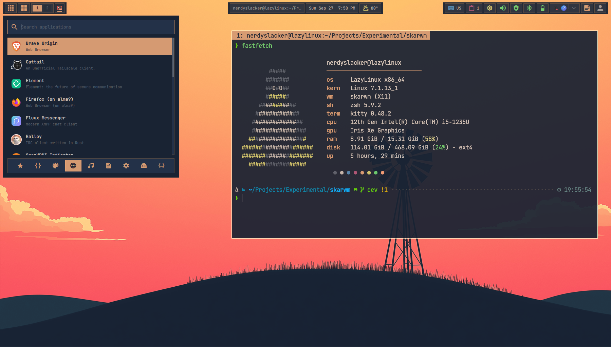

<div align="center">
<a href="https://github.com/nerdyslacker/anush"></a>
</div>
<h1 align="center">anush</h1>
<div align="center">

[](https://github.com/nerdyslacker/anush/blob/main/LICENSE)
[](https://github.com/nerdyslacker/anush/releases)
<a href="https://app.commanddash.io/agent?github=https://github.com/nerdyslacker/anush"></a>
[](https://github.com/nerdyslacker/anush/stargazers)
[](https://github.com/nerdyslacker/anush/fork)

</div>

**anush** (_[ɑˈnuʃ]_) is a desktop shell named after my wife (_Անուշ_) built with
[Quickshell](https://quickshell.org/) to make any X11 wm as beautiful as she
makes my life. It provides the bar, launcher,
notifications, desktop controls, wallpaper and theme integration while leaving
window management to the active WM.

<div align="center">

</div>

## Supported window managers

anush has dedicated adapters for:

- skarwm
- bspwm
- herbstluftwm
- i3
- spectrwm
- dwm
- Openbox

Unknown EWMH-compatible window managers use the generic adapter. Features are
shown only when the active adapter supports them.

## Requirements

Core requirements:

- Quickshell
- Python 3
- `xprop`
- ImageMagick (`magick`) for wallpaper palettes and Alt+Tab window previews
- Fontconfig (`fc-list`)
- JetBrainsMono Nerd Font (default UI font; other installed Nerd Fonts are selectable)
- Symbols Nerd Font Mono
- the active WM's control utility, such as `skarwm-msg`, `bspc`, or
  `herbstclient`

Picom is recommended for transparency and window corner effects. Individual
widgets may need additional programs; each requirement is documented in the
[widget guide](docs/widgets/README.md).

## Install

```sh
sudo make install
```

This installs the shell, helpers, assets, defaults, and `anushctl`. Package data
is read from the installation prefix; mutable files remain in the user's config,
state, and data directories.

Start the shell as the desktop user:

```sh
anushctl start
```

The window manager should run that command from its normal autostart mechanism.
For skarwm:

```text
autostart : "anushctl start"
```

After upgrading, reload the installed QML with:

```sh
anushctl reload
```

Use `anushctl restart` only when a complete process restart is needed.

## Configuration

| Data | Default location |
| --- | --- |
| Optional user overrides | `${XDG_CONFIG_HOME:-$HOME/.config}/skarwm/anush/config.json` |
| Persistent shell state | `${XDG_STATE_HOME:-$HOME/.local/state}/anush/shell-state.json` |
| Notepad files | `${XDG_DATA_HOME:-$HOME/.local/share}/anush/notepad/` |

Installed defaults come from `config/defaults.json`. User overrides merge over
those defaults, and settings changed from the shell are stored in the state
file. See [configuration.md](docs/configuration.md) for precedence, environment
overrides, and file ownership.

The backend defaults to automatic WM detection. It can be overridden in
`config.json`:

```json
{
  "windowManager": {"backend": "bspwm"}
}
```

## Useful commands

```sh
anushctl status
anushctl launcher toggle
anushctl notes toggle
anushctl popup network
anushctl wallpaper set ~/Pictures/wallpaper.jpg
anushctl theme mode dark
anushctl lock
```

See [anushctl.md](docs/anushctl.md) for the complete command reference.

## Documentation

- [Widget guide](docs/widgets/README.md)
- [Configuration](docs/configuration.md)
- [skarwm integration](docs/skarwm.md)
- [Real WM testing](docs/wm-testing.md)

## Repository layout

```text
config/                 installed defaults and application templates
shell/common/           shared QML services and WM adapters
shell/components/       UI grouped by feature
shell/scripts/          helper programs grouped by feature
shell/shell.qml         Quickshell entry point
tools/                   development and real-WM testing tools
```

## Inspiration

The desktop setup was inspired by
[drew/butterdwm](https://justaguy.dev/drew/butterdwm).
