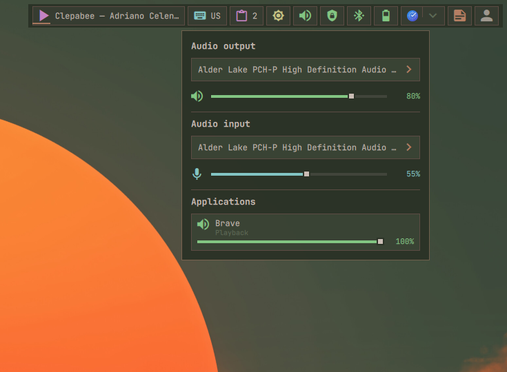
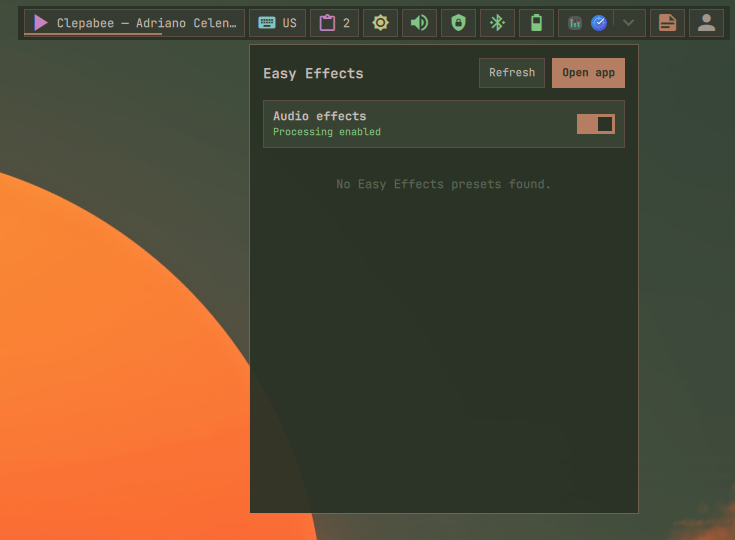

# Audio

Shows the default output volume and mute state. Its popups provide stream,
device, microphone, and Easy Effects controls.

The mixer uses PulseAudio-compatible `pactl`; `pavucontrol` opens the full
mixer. When Easy Effects is installed, the right-click popup controls bypass,
input/output presets, and the full application. The normal mixer remains
available without Easy Effects.

## Actions

- **Left click:** Open the audio mixer.

  

- **Middle click:** Mute or unmute the default output.

- **Right click:** Open Easy Effects controls.

  

- **Scroll:** Raise or lower volume in two-percent steps and unmute the output.
