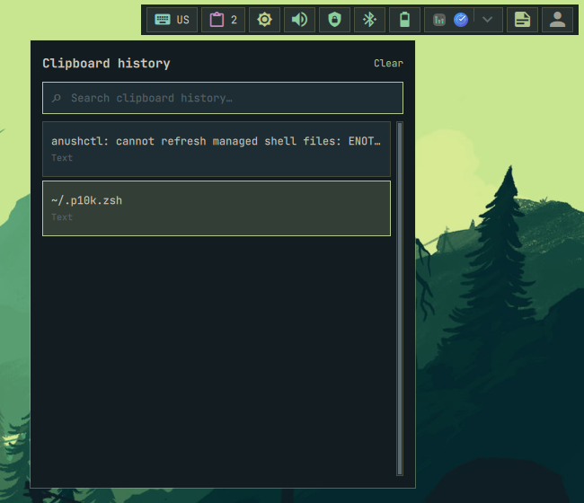

# Clipboard

Provides searchable clipboard history through the configured minni or clipmenu
provider.

## Actions

- **Left, middle, or right click:** Open or close clipboard history.

  

`clipboard.pasteShortcut` defaults to `auto`: terminals use `Ctrl+Shift+V` and
other applications use `Ctrl+V`. It also accepts `shift+insert`,
`ctrl+shift+v`, or `ctrl+v`.
