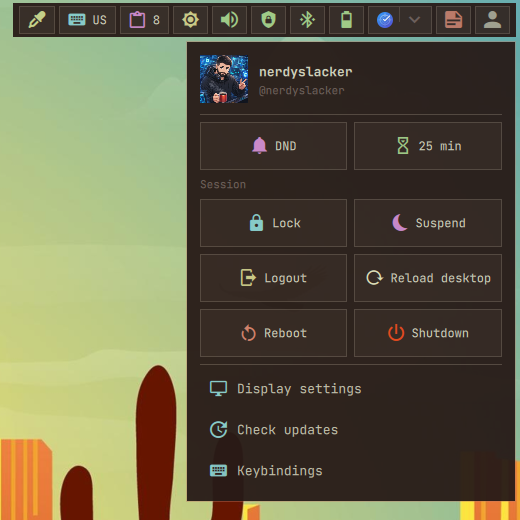
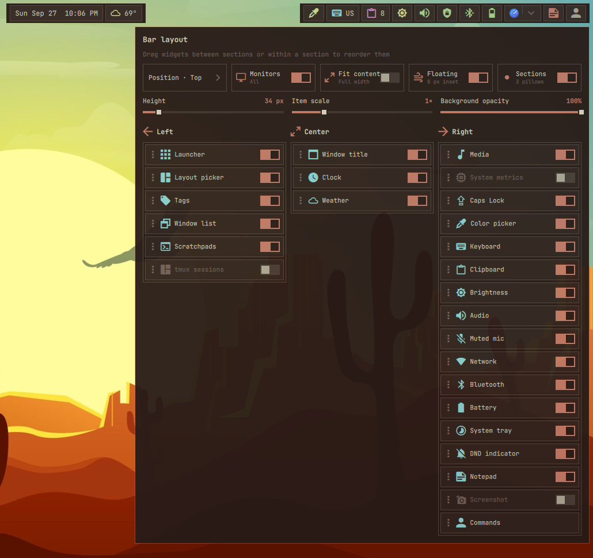

# Commands

Opens session, focus, display, power, notification, and Pomodoro controls. This
widget also provides one of the bar configuration entry points and can be
hidden from Bar Layout.

The **skarwm settings** entry opens a staged graphical editor for the active
`skarwm.rc` (or legacy `config.rc`). It covers window styling, decorations, animations, autostart
commands, bindings, rules, workspace layouts, virtual screens, and advanced
compatibility entries. Imported rc files are loaded recursively, so their
bindings and other entries appear in the same editor; edited rows are written
back to their source files. The entry is shown only while skarwm is the active
window manager. **Save & Reload** validates the values and rolls changed files
back automatically if skarwm rejects the reload.

## Actions

- **Left click:** Open or close the commands menu.

  

- **Middle click:** Open the searchable keybindings view when supported by the
  active window manager.

- **Right click:** Open bar layout and visibility settings.

  

Bar Layout can also be opened by right-clicking empty space on the bar, even
when the Commands widget is hidden.

Bar Layout controls position, monitor visibility, fit-to-content mode, floating
insets, separated sections, height, scale, opacity, widget visibility, and the
three widget clusters. Its height follows the longest cluster and becomes
scrollable only when it reaches the available screen edge.

The display settings entry stages XRandR mode, refresh, scale, orientation,
primary output, mirroring, and monitor positions. Disruptive changes must be
confirmed within 15 seconds or the rollback watchdog restores the previous
layout.

On first launch, `anushctl start` seeds the bundled Fastfetch configuration and
links Fastfetch's standard config path to it. An existing regular config is
preserved as `config.jsonc.pre-anush`; colors follow the active anush theme.
