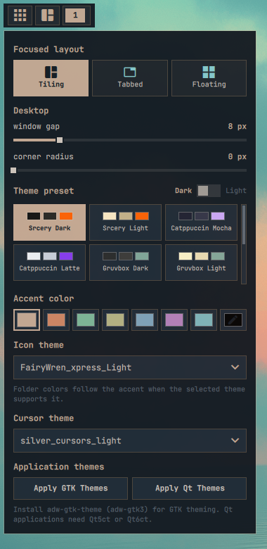
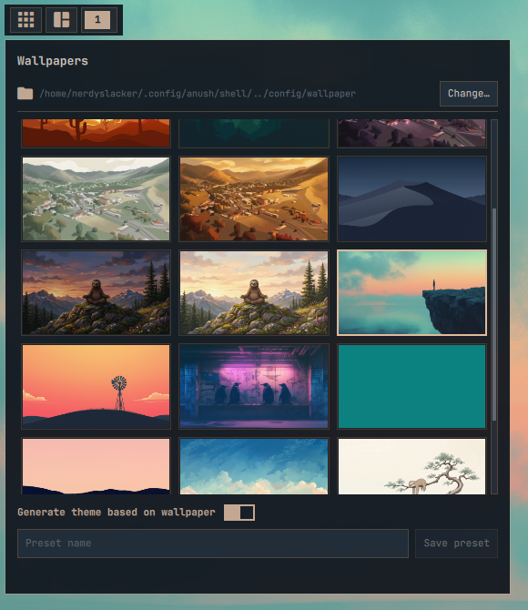

# Layout picker

Shows the active WM layout and provides layout, compositor, gap, window
decoration, corner-radius, theme, wallpaper, icon, and cursor controls. Layouts
are supplied by the active WM adapter, so unsupported controls stay hidden.

Every supported WM uses miniature pane diagrams for its layouts. Known tiling,
grid, tabbed, stacking, monocle, dwindle, and floating modes get distinct
shapes; dynamically discovered bspwm and dwm layouts use the closest matching
shape and fall back to a tiled diagram.

The corner-radius slider always changes shell surfaces. Picom must be enabled
for compositor-provided window corners; skarwm applies its native window radius
live. The value is stored as `theme.cornerRadius`, where zero keeps
non-circular surfaces square.

The Picom switch starts or stops the compositor immediately and persists the
preference. Separated bar sections need an X11 compositor so the unused panel
area remains transparent.

## Themes

The picker includes bundled dark and light presets and wallpaper-derived
palettes. Package presets live under `config/themes/presets`; user presets under
`$XDG_CONFIG_HOME/skarwm/anush/themes/presets` can replace a package preset with
the same id.

Wallpaper palettes use matugen when available and fall back to the bundled
ImageMagick generator. Generated palettes can be saved under a custom name.
When matugen produced the active palette, **Apply GTK Themes** and **Apply Qt
Themes** update writable user configuration for supported toolkits without
modifying package data. GTK integration expects `adw-gtk3`; Qt integration uses
Qt5ct, Qt6ct, and KDE-compatible color schemes where available.

## Actions

- **Left click:** Open appearance and layout controls.

  

- **Middle click:** Apply a random wallpaper.
- **Right click:** Open the wallpaper picker.

  

- **Scroll:** Cycle through workspace layouts.
