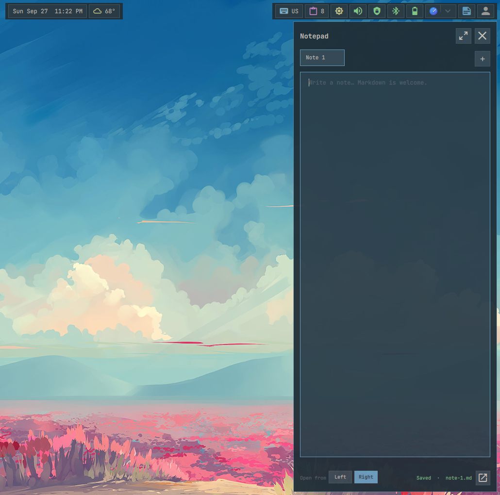

# Notepad

Opens a screen-side notes editor for Markdown and text files. Its color and dot
indicate unsaved changes or save conflicts.

Notes are tabbed UTF-8 files under
`${XDG_DATA_HOME:-$HOME/.local/share}/anush/notepad/`. The header creates files,
switches between compact and extended width, and closes the sidebar; the footer
selects the screen edge. Writes are debounced and atomic, and external changes
never discard unsaved in-memory text. `ANUSH_NOTEPAD_DIR` changes the directory;
`ANUSH_NOTES_FILE` selects one legacy file.

## Actions

- **Left, middle, or right click:** Open or close the notepad sidebar on that screen.

  

The sidebar also supports `anushctl notes toggle`, `anushctl notes new`, and
`anushctl notes save`.
