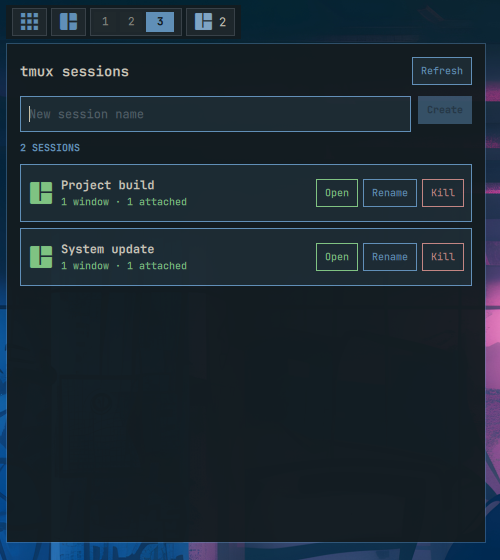

# tmux sessions

Shows the number of tmux sessions and provides a compact session manager when
tmux is installed.

The popup creates, attaches, renames, and removes sessions. Removal requires a
second confirmation click. New sessions open in `$TERMINAL`, Kitty, Foot,
Alacritty, WezTerm, or XTerm.

## Actions

- **Left click:** Open the tmux session manager.

  

- **Middle click:** Refresh the session list.
